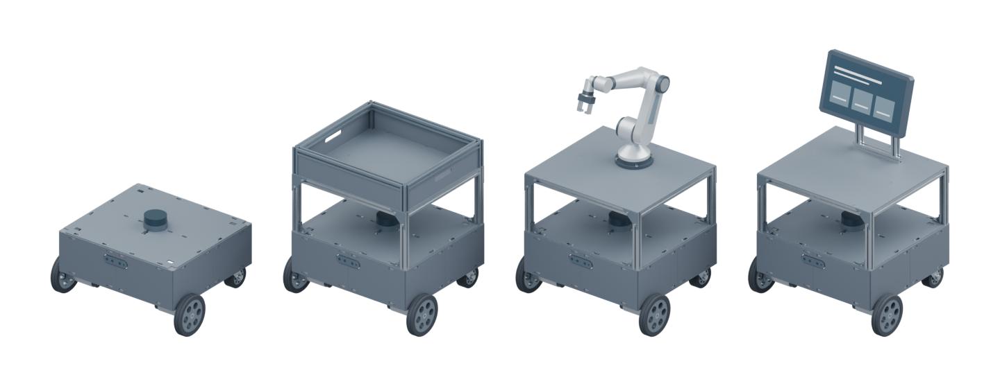
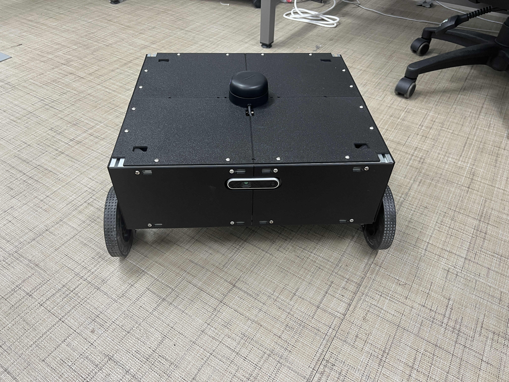
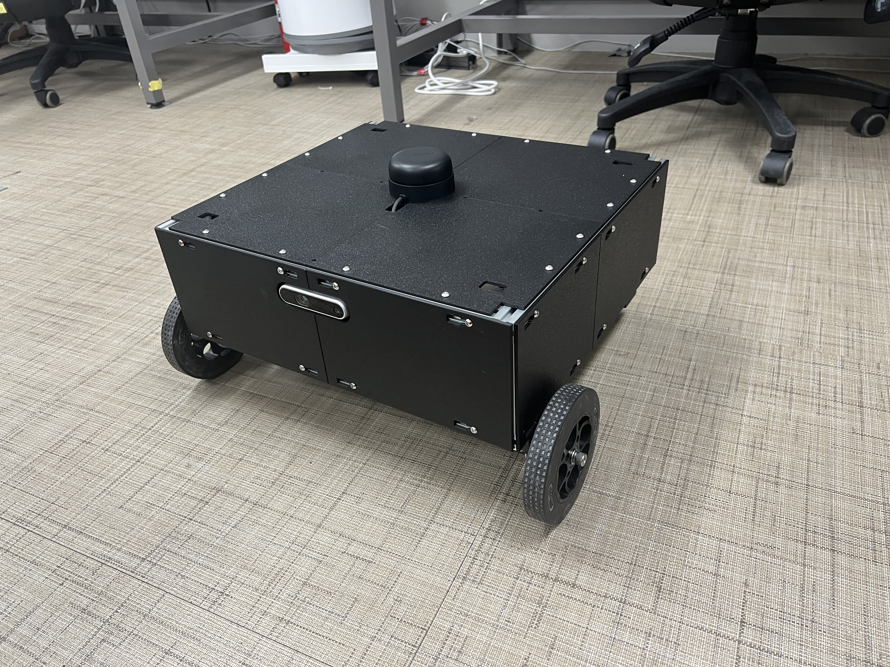
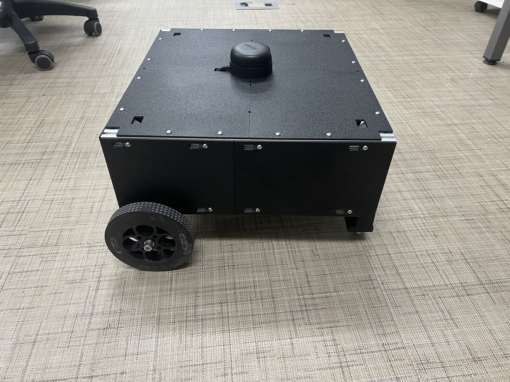

<p align="center">
  
</p>

<h1 align="center">Oh My Control</h1>

<p align="center">
  <em>모바일 로봇 하드웨어 브링업 · Mega 1 kHz 모터 제어 · 구동/센서 캘리브레이션</em>
</p>

<p align="center">
  <a href="#completed-robot">완성 사진</a> ·
  <a href="#robot-video">주행 영상</a> ·
  <a href="#quick-start">바로 실행</a> ·
  <a href="#teleop-and-stop">키보드 조종</a> ·
  <a href="#sensor-check">센서 검사</a> ·
  <a href="#pid-and-autotune">PID 보정</a> ·
  <a href="docs/motor_control_spec.md">모터 제어 명세</a> ·
  <a href="docs/control_timing.md">제어 주기</a> ·
  <a href="docs/imu_calibration.md">IMU 보정</a>
</p>

---

**Oh My Control**은 선행 프로젝트인 [`Oh-My-MobileRobot`](https://github.com/Leehyunbin0131/Oh-My-MobileRobot)(로봇 하드웨어 제작 및 기구·URDF 설계)의 다음 단계로, **상위 ROS 2 자율주행 스택을 올리기 직전의 하드웨어 브링업(Bring-up)·저수준 제어 펌웨어·구동/센서 캘리브레이션**을 완성한 베이스라인 저장소입니다.

로봇의 물리적 하드웨어(모터·엔코더·IMU·LiDAR·RealSense)가 의도한 제어 명령과 주행 물리 특성대로 정확히 동작하는지 **ROS 2 노드 의존성 없이 독립적으로 검증·보정**하는 데 초점을 맞추고 있습니다.

| 단계 | 저장소 | 핵심 역할 |
| :--- | :--- | :--- |
| **Step 1. 기구·모델링** | [`Oh-My-MobileRobot`](https://github.com/Leehyunbin0131/Oh-My-MobileRobot) | 로봇 하드웨어 설계/제작, CAD 및 URDF 모델 정의 |
| **Step 2. 제어·보정 (현재)** | **`Oh-My-Control`** | **Mega 1 kHz 속도/위치 유지 제어 펌웨어, 모터/IMU 보정, 센서 통합 진단** |
| **Step 3. 자율주행** | 차기 ROS 2 Sim & Bringup | Step 2의 보정값·프로토콜(`OMR1`) 기반 ROS 2 드라이버 및 SLAM/Nav2 자율주행 |

<a id="completed-robot"></a>

## 실제 완성 모습

<p align="center">
  <br>
  <sub>완성된 기본 베이스의 전면</sub>
</p>

| 전면 사시 | 측면·상판 |
| :---: | :---: |
|  |  |

<a id="robot-video"></a>

### 주행 영상

<table align="center"><tr><td>

https://github.com/user-attachments/assets/bb98cf7c-ee6c-49f0-b458-9154ca7bda5a

</td></tr></table>

<p align="center">
  <sub>저장소 내 원본 영상 파일: <a href="docs/videos/robot-driving.mp4"><code>docs/videos/robot-driving.mp4</code></a></sub>
</p>

## 제어·검증 요약

최종 정리: **2026-11-06**. 현재 소스는 **Mega v8 / `signed_pwm_v1`**이며, 오른쪽 모터 전원선 극성을 바꾼 배선을 유지합니다.
기본 목표는 **72 RPM**, 실측 보정한 주행 상한은 **95 RPM**, MCU의 절대 목표·과속 보호 기준은 **100 RPM**입니다. PID 계산은 Mega에서 실제 1000 Hz로 실행합니다.

**무부하 PID 재보정·오토튠과 주행·0 RPM 제동 검증을 완료했습니다.**
오토튠 36개 실험 묶음과 최종 18조건을 통과했습니다. 최대 평균 속도 오차는 0.39 RPM이며 `config/motor_pid.json`에 검증된 계수를 저장했습니다.
위치 유지는 `hold.enabled=true`입니다. **목표 0을 적용하는 첫 제어 주기에 현재 위치를 저장하고 즉시 HOLD에 진입합니다.** 직접 위치 P와 속도 피드백, PWM 상한 350을 사용합니다. 같은 유지 계수의 정지 상태 저항력은 2026-11-05 사용자 수동 시험으로 확인했습니다. 즉시 진입 변경판도 업로드했으며, 실제 주행 중 제동은 사용자 확인 대기입니다.

기존 주행·제동 검증 근거: 로컬 원본 보고서 `reports/pid_recalibration_v8_20261105_124619/summary.json` (18조건 실측 수치와 오토튠 비교 결과는 [config/motor_pid.json](config/motor_pid.json)에 내장). 바퀴를 띄운 상태에서 검증했으며 지면 주행·위치 유지 검증은 별도입니다.
변경 내용과 검증 기준: [모터 제어 명세서](docs/motor_control_spec.md).
제어 주기 결정과 무구동 통신 비교: [제어·통신 주기 기준](docs/control_timing.md). 현재 **PID 1000 Hz·목표 송신 50 Hz·상태 수신 20 Hz를 유지**합니다. Nav2는 ROS 연동 후 SLAM 동시 실행 상태에서 **20·30·50 Hz를 비교**해 결정합니다. 아직 ROS 모터 어댑터·오도메트리·Nav2 연동은 구현하지 않았습니다.

## Git 저장소 사용

처음 내려받을 때는 `git clone --recurse-submodules <저장소주소>`를 사용합니다.
이미 내려받았다면 아래 명령으로 공식 라이다 소스를 가져옵니다.

```bash
git submodule update --init --recursive
```

`src/rplidar_ros`는 검증 당시 커밋으로 고정한 서브모듈입니다. 소스·설정·문서는 Git으로 관리하고, `reports/`, `build/`, `install/`, `log/`, `.tools/`와 전체 백업은 로봇에 보관합니다. 문서의 `reports/` 링크는 로봇의 원본 워크스페이스에서 확인할 수 있습니다. 새 기기에서는 ROS·센서 라이브러리와 Arduino 도구 설치 및 빌드가 별도로 필요합니다.

<a id="quick-start"></a>

## 바로 실행

로봇에 SSH로 접속한 뒤 실행합니다. 아래 프로그램은 하나씩 사용하세요.

```bash
cd ~/ros2_dev_ws
./hardware_tui.sh --motors       # 센서·모터 상태 대시보드; 모터 구동 없음
./check_sensors.sh              # 외장 IMU, 라이다, 카메라·내장 IMU 검사
./teleop.sh                     # 기본 72 RPM PID 조종, 한 번 입력하면 방향 유지
```

기본 의존성은 이 기기에 설치되어 있습니다. Python 도구는 바로 실행하며, IMU 보정용 카메라 수집기는 필요할 때 자동 빌드합니다.
SSH 명령에서 바로 실행할 때는 `ssh -t hyunlee@로봇주소 'cd ~/ros2_dev_ws && ./hardware_tui.sh'`처럼 터미널을 할당합니다.

<a id="teleop-and-stop"></a>

## 키보드 조종과 정지

방향키를 **한 번 누르면 주행을 유지**합니다. 키를 놓아도 정지하지 않습니다.

| 키 | 동작 |
| --- | --- |
| `q` / `w` / `e` | 왼쪽 곡선 전진 / 직진 / 오른쪽 곡선 전진 |
| `a` / `d` | 제자리 좌회전 / 우회전 — PID 모드 최대 50 RPM |
| `z` / `x` / `c` | 왼쪽 / 직선 / 오른쪽 후진 |
| `s` / `Space` | 정지 |
| `+` / `-` | PWM 10씩 조절; PID 모드에서는 2 RPM씩 조절 |
| `Ctrl+C` / `Ctrl+D` | 정지 후 종료 |

기본 `./teleop.sh`는 엔코더 피드백으로 72 RPM을 유지하며, `./teleop.sh --rpm 50`처럼 목표를 지정할 수 있습니다.
제자리 회전(`a`/`d`, 좌우 화살표)은 각 바퀴 목표를 최대 **50 RPM**으로 제한합니다. 선택한 주행 속도가 50 RPM보다 낮으면 그 속도를 사용합니다. 전·후진과 곡선 주행은 기존 속도 설정을 사용하며, 회전 중 `+`를 눌러도 회전 목표는 50 RPM을 넘지 않습니다.
`./teleop.sh --pwm 180`은 PID 없이 출력을 직접 지정하는 진단용 모드이며, 실제 180 RPM을 뜻하지 않습니다.
선택 사항인 `--key-timeout 0.6`은 입력이 0.6초 동안 없으면 정지합니다.

PID 모드의 `s`/`Space`는 **목표 0 RPM → 다음 1 ms 제어 주기에서 즉시 HOLD**로 처리합니다. 호스트·시리얼·드라이버 전송 시간은 별도입니다.
목표 0을 적용할 때의 엔코더 위치를 한 번 저장하며, 반복되는 정지 명령은 기준 위치를 바꾸지 않습니다. 유지 전용 위치 P와 속도 피드백이 처음부터 PWM 350 한도 안에서 제동·유지합니다. 관성으로 지나치면 저장한 위치로 돌아오려는 출력이 생깁니다. 새 방향 명령을 받으면 즉시 주행 제어로 전환합니다. 100 ms 안정 판정은 상태 표시와 종료 확인에만 쓰며 HOLD 진입을 지연시키지 않습니다.
속도·방향 변경은 주행 중 갱신하며, 기존 200 ms 대기와 별도 `BRAKE` 루틴은 제거했습니다.
제동 중 PID가 반대 극성 PWM을 계산할 수 있습니다. 전류·토크를 직접 제어하는 방식은 아닙니다.

`STOP`은 제어 해제·출력 0을 뜻하며, 직접 PWM 진단과 오류 정지에서 사용합니다.
목표는 50 Hz로 갱신하며 유효기간은 300 ms입니다. `PING`만으로 이동 목표가 연장되지 않습니다.
위치 유지도 유효한 0 목표가 갱신되는 동안 계속됩니다. 10초가 지났다는 이유로 해제하지 않으며, 명령 만료·오류·종료 시에는 출력을 해제합니다.
정상 종료는 최대 1초 동안 피드백 정지를 시도한 뒤 출력을 해제합니다. 오류·통신 만료에서는 바로 출력 해제를 요청합니다.
`STOP`은 기존 오류를 지우지 않습니다. 원인을 해소한 뒤 `./teleop.sh --clear-fault`로 명시적으로 해제합니다.
USB 연결로 Mega가 재부팅되면 오류 기록도 초기화되지만, 새 구동 명령 없이 움직이지 않습니다.

현재 기기에 즉시 HOLD 변경판 업로드를 완료했습니다. `./mega_firmware.sh upload`는 모터 전원을 끈 상태에서 실행합니다. 기존 기능 마스크 15 펌웨어에서는 강화 설정을 시작하기 전에 업로드 필요 오류로 차단합니다.
사용자가 직접 `./teleop.sh --rpm 30`으로 짧게 주행 후 `s`를 누르고, 양쪽 상태가 `HOLD`로 바뀌는지 확인합니다. 10초 이상 기다려도 `HOLD`가 유지되는지와 화면의 위치 오차·PWM, 재출발 시 반응을 확인합니다. 처음 실행하자마자 `s`만 누르면 출력 해제 상태를 유지하므로 주행 후 시험합니다.
실내 평탄한 바닥과 지속적인 외력이 거의 없는 조건을 대상으로 합니다. 직접 위치 P는 18 PWM/count, 속도 Kp 8·Ki 0, 위치 데드밴드는 1 count입니다. 한도는 위치 오차 100 counts, 유지 PWM 350이며 출력 포화가 1초 지속되면 오류로 해제합니다. 이때 `hold_limit (fault 10)`으로 원인을 표시합니다. 상세 설정은 [모터 제어 명세서](docs/motor_control_spec.md)에 있습니다.

직접 PWM 진단도 최대 650으로 제한합니다. 측정 속도가 100 RPM을 초과한 상태가 100 ms 지속되면 과속 오류로 해제합니다.
100 RPM은 명령 상한이며 순간적인 실제 속도 초과까지 막는 보장은 아닙니다. 실측에서 100 RPM 목표는 오른쪽 과속 보호가 동작해, 검증된 주행 범위를 95 RPM까지로 정했습니다. 지면 정지 거리·방향 변화는 별도 검증이 필요합니다.

<a id="sensor-check"></a>

## 센서·엔코더 검사

```bash
./check_sensors.sh --sensors imu
./check_sensors.sh --sensors lidar --lidar-baud 256000
./check_sensors.sh --sensors camera --duration 10
./check_sensors.sh --sensors motors --motor-test encoders --duration 20
```

`camera`는 RGB·깊이 영상과 내장 가속도계·자이로를 함께 검사합니다.
`encoders` 검사에서는 측정 중 두 바퀴를 각각 손으로 돌립니다.
종료 코드는 전체 통과 `0`, 실패 `1`, 인자 오류 `2`, 사용자 중단 `130`입니다.

대시보드는 로봇 자세, 카메라 문자 영상, 라이다 분포와 엔코더를 표시합니다.

| 대시보드 키 | 동작 |
| --- | --- |
| `1` / `2`, `z` | 외장 / 카메라 IMU 선택, 현재 자세를 표시 기준으로 설정 |
| `c`, `+` / `-` | 컬러·깊이 전환, 라이다 표시 반경 조절 |
| `s`, `r`, `q` | 상태 저장, 드라이버 재시작, 종료 |
| `m`, `Space` / `x` | 구동 검사 허용 시 시작, 검사 중단·정지 |

카메라 IMU의 자세는 가속도·자이로로 추정한 상대 자세이며 yaw는 드리프트할 수 있습니다.
화면이 좁으면 터미널을 120열 × 42행 정도로 넓히고, 색이 맞지 않으면 `--color none`을 사용합니다.

SLAM 준비용 정지 자이로 보정은 `./calibrate_imu.sh --stationary`로 두 IMU를 함께 측정합니다.
보정값은 `config/imu_calibration.json`에 저장하며 현재 주행·센서 표시에 자동 적용하지 않습니다. 재실행 방법, 결과와 향후 TF·엔코더·시간 보정 항목은 [IMU 보정 문서](docs/imu_calibration.md)에 정리했습니다. 대시보드의 `z`는 화면 기준 설정이며 센서 캘리브레이션이 아닙니다.

모터 구동 검사는 **바퀴를 띄운 상태**에서 실행합니다.

```bash
./hardware_tui.sh --motors --motor-test drive   # 화면에서 m으로 시작
./check_sensors.sh --sensors motors --motor-test drive
./check_sensors.sh --sensors motors --motor-test bench --motor-bench-seconds 30
```

일반 모터 검사와 시간 제한 종료는 출력 0으로 정지합니다. 키보드 조종의 빠른 제동과 구분합니다.

## 현재 하드웨어와 방향

| 장치 | 설정 |
| --- | --- |
| 외장 IMU HFI-A9 | USB 시리얼 921600 bps |
| RPLIDAR A2M12 | USB 시리얼 **256000 bps**, 공식 `rplidar_ros` |
| RealSense | RGB·깊이 640×480 @ 15 fps, 내장 IMU 사용 |
| Arduino Mega 2560 | USB 115200 bps, 엔코더 샘플링 20 kHz |
| NT-S-DCDM1210 | I²C 400 kHz, 주소 `0x01`, DIP 모두 ON, Mega SDA20/SCL21 |

USB 장치는 `/dev/serial/by-id/` 경로를 사용합니다. 공통 장치 인자는 `./check_sensors.sh --help`에서 확인합니다.
라이다·카메라 검사는 ROS 도메인 77을 사용합니다. 카메라는 이 기기의 `~/.local/opt/librealsense-2.58.1-rsusb/lib`를 사용합니다.

전방은 RealSense가 보는 방향이며, 좌우는 로봇 뒤에서 전방을 볼 때 기준입니다.

| 실제 바퀴 | 드라이버 | 엔코더 A/B | 전진 명령 부호 | 전진 시 원시 엔코더 부호 |
| --- | --- | --- | --- | --- |
| 왼쪽 | L / M2 | D50 / D51 | − | − |
| 오른쪽 | R / M1 | D40 / D41 | − | + |

현재 방향의 기준 파일은 [config/drive_calibration.json](config/drive_calibration.json)입니다.
호스트가 실제 전진을 양수로 변환합니다. 펌웨어의 PID 피드백 부호는 드라이버 `[L, R]` 순서로 `[+1, -1]`입니다.
드라이버 매뉴얼은 [NT-S-DCDM1210.pdf](NT-S-DCDM1210.pdf)에 있습니다.

<a id="pid-and-autotune"></a>

## PID 보정과 오토튠

PID 계산은 Mega Timer1에서 **1000 Hz / 1 ms**로 실행합니다. I²C 출력 전송 주기는 이 계산 주기와 별개입니다.
이번 오토튠에서 PID 계산 주기 누락은 0회였으며, 활성 구간의 I²C 출력 갱신은 평균 약 580 Hz였습니다.
속도 환산은 명목 엔코더 해상도 2652 counts/rev를 사용하며, 실제 한 바퀴당 카운트는 별도 보정하지 않았습니다.

[config/motor_pid.json](config/motor_pid.json)은 v8 제어 모델과 일치하는 schema 2 설정입니다.
현재 `validated: true`, `autotune.completed: true`이며 주행·제동 검증을 통과했습니다.
손으로 확인한 유지력은 `hold_validation.status=user_confirmed_manual_hold`로 기록했습니다. 정량 유지력과 지면 제동 검증은 별도이므로 `validation_status.holding`과 `ground`는 아직 `false`입니다. RPM은 명목 엔코더 해상도에 따른 값입니다.

모터 전원을 켜고 바퀴를 띄운 뒤 보정합니다. **아래 앞의 두 명령은 실제 모터를 구동합니다.**

```bash
./tune_motors.sh              # 새 주행 PI 보정 + 0 RPM 제동 검사, 기본 상한 95 RPM
./tune_motors.sh --autotune   # 검증된 v8 설정에서 주행 Kp/Ki/Kd 탐색 + 제동 재검사
./teleop.sh --rpm 50         # 50 RPM 조종
```

과거 배선·v7 검증을 새 검증으로 재사용하지 않습니다. 후보가 통과한 경우에만 현재 설정을 교체합니다.
현재 PWM 상한 650에서 100 RPM 목표는 왼쪽 출력 포화와 오른쪽 과속 보호가 관찰되어 95 RPM을 채택했습니다. `--max-rpm`으로 보정 범위를 지정할 수 있으며, 기준에 미달하면 기존 설정을 교체하지 않습니다.
절대 목표 상한은 100 RPM이며 초과 인자는 거부합니다. 주행 계수 자동 탐색은 위치 유지 PI를 보정하거나 위치 유지의 실기 검증 상태를 변경하지 않습니다.

오류 원인을 해소한 경우 보정 명령에 `--clear-fault`를 추가할 수 있습니다.
지면 정지 거리·방향 틀어짐과 위치 유지 시험은 별도로 진행하고, 측정 전에는 검증 완료로 표시하지 않습니다.

통신 오류 수정에서는 수신 버퍼를 256바이트로 늘리고, 상태 정보 생성 중 I²C 호출을 제거했습니다.
진단 프레임을 나누어 명령 수신을 먼저 처리합니다. `motors_commands.jsonl`에 송신 명령을, `motors_serial.log`에 원본 응답을 저장합니다.
수신 버퍼 사용량·처리 지연·CRC/프레임/순서 오류는 `R` 진단으로 확인합니다. PID 계산과 I²C 출력 갱신 속도는 각각 기록합니다.

## 야외 SSH용 핫스팟

```bash
sudo ./hotspot_on.sh             # 부팅 자동 시작 켜기 + 5초 후 현재 연결을 핫스팟으로 전환
sudo ./hotspot_on.sh --boot-only # 현재 연결을 유지하고 다음 부팅부터 핫스팟 사용
sudo ./hotspot_off.sh            # 자동 시작 끄기; 현재 Wi-Fi/핫스팟 연결은 유지
sudo ./hotspot_on.sh --status    # 현재 Wi-Fi 이름·비밀번호·SSH 주소 확인
```

핫스팟 이름은 **ORINBOT**, Wi-Fi 비밀번호는 **12345678**, 접속 명령은 `ssh hyunlee@10.42.0.1`입니다.
Wi-Fi 비밀번호와 SSH 계정 인증은 별개입니다. 핫스팟으로 전환되면 노트북도 ORINBOT에 연결한 뒤 SSH로 재접속합니다.
자동 시작을 끄면 다음 부팅에는 저장된 일반 Wi-Fi 연결을 시도합니다.
로그는 `sudo journalctl -u robot-hotspot.service -u robot-hotspot-activate.service -n 50 --no-pager`로 확인합니다.

## 빌드와 검증

현재 기기의 펌웨어 도구 설치 위치는 `.tools/arduino/`이며, CLI와 AVR 코어가 설치되어 있습니다.
CLI는 `bin/`, AVR 코어는 `arduino-cli.yaml`이 가리키는 `data/`를 사용합니다.

새 보드나 초기화된 환경에서 도구를 재설치할 때는 아래 순서로 준비합니다:

```bash
# 1. Python 의존성
/usr/bin/python3 -m pip install pyserial numpy Pillow wcwidth

# 2. 로컬 Arduino CLI 및 AVR 코어 (.tools/arduino)
mkdir -p .tools/arduino/bin .tools/arduino/data .tools/arduino/downloads .tools/arduino/sketchbook
curl -fsSL https://raw.githubusercontent.com/arduino/arduino-cli/master/install.sh | BINDIR=.tools/arduino/bin sh
cat > .tools/arduino/arduino-cli.yaml << 'EOF'
 directories:
   data: .tools/arduino/data
   downloads: .tools/arduino/downloads
   user: .tools/arduino/sketchbook
EOF
./.tools/arduino/bin/arduino-cli --config-file .tools/arduino/arduino-cli.yaml core update-index
./.tools/arduino/bin/arduino-cli --config-file .tools/arduino/arduino-cli.yaml core install arduino:avr
```

```bash
./mega_firmware.sh build         # 현재 I²C 펌웨어 빌드만 수행
./mega_firmware.sh upload        # 모터 전원을 끄고, 장치 사용 프로그램 종료 후 업로드
/usr/bin/python3 -m unittest discover -s tests -v
```

자동 테스트는 가상 시리얼·모터 모델과 C++ 코어를 사용하며 실제 모터를 구동하지 않습니다.
전체 검사 결과는 로컬 보고서 `reports/motor_hold_stiffness_20261105/summary.json`에 보관합니다. 즉시 HOLD 변경은 첫 제어 주기 진입, 반복 명령의 기준 보존, 재출발·출력 해제에 한정해 검증합니다.
공식 라이다만 실행하려면 대시보드를 종료한 뒤 `./lidar_official.sh`를 사용합니다.
라이다를 다시 빌드할 때는 다음을 실행합니다.

```bash
source /opt/ros/jazzy/setup.bash
colcon build --packages-select rplidar_ros --symlink-install --allow-overriding rplidar_ros
```

## 문서와 파일

| 문서 · 경로 | 제공 내용 |
| --- | --- |
| [모터 제어 명세서](docs/motor_control_spec.md) | Mega v8 속도 PID, 즉시 HOLD 제동·위치 유지, `OMR1` 시리얼 프로토콜 및 검증 수치 |
| [제어·통신 주기 기준](docs/control_timing.md) | 1 kHz PID·50 Hz 목표 송신·20 Hz 텔레메트리 주기 기준 및 UART 링크 프로파일링 |
| [IMU 보정 문서](docs/imu_calibration.md) | 외장 HFI-A9·RealSense D435IF 정지 자이로 영점 보정 절차 및 실측 결과 |
| [구동 방향 설정](config/drive_calibration.json) · [PID 설정](config/motor_pid.json) · [IMU 보정값](config/imu_calibration.json) | 좌우 바퀴·엔코더 부호 매핑, 18조건 검증 통과 PID 계수, IMU 자이로 바이어스 |
| 루트의 `*.sh` · `tools/` · `firmware/mega_motor_test/` · `tests/` | 센서 검사·조종·보정·펌웨어·핫스팟 실행 진입점, Python 도구, Mega 펌웨어, 103개 자동 테스트 |
| `docs/images/`, `docs/videos/`, `src/rplidar_ros/`, `resources/` | 완성 사진·주행 영상(`robot-driving.mp4`), 공식 라이다 소스, 표시용 URDF·모델 라이선스 |

로컬 검증 결과 안내서는 `reports/README.md`에 모았습니다. 과거 보고서는 당시 버전의 이력이며 현재 성능으로 간주하지 않습니다.
전체 작업 백업은 워크스페이스 밖 `~/robot_backups/`에 저장합니다. 압축 파일과 SHA-256 체크섬을 함께 보관하며, 빌드 환경과 원본 보고서도 포함합니다.

## 다음 개발 (차기 ROS 2 자율주행 단계)

1. 바퀴 반지름·윤거·실제 엔코더 CPR을 측정하고 ROS 2 모터 어댑터와 엔코더 오도메트리를 연결합니다.
2. 센서·SLAM·Nav2 동시 실행 상태에서 Nav2 20·30·50 Hz를 비교합니다. 명령 지연, 데이터 나이, 주기 누락과 실제 경로 추종 오차를 기록합니다.
3. 사용자가 지면 정지 거리·방향 변화와 위치 유지를 시험합니다. 결과를 기록하기 전까지 위치 유지의 실기 검증 상태는 미완료로 둡니다.
4. 메가의 실제 실행 여유가 부족할 때만 PID 500 Hz를 별도 비교합니다. 시간 계산과 필터를 수정하고 다시 검증하며, Nav2 주기와 동시에 변경하지 않습니다.

## 라이선스

저장소의 펌웨어, 제어·보정 도구, 테스트 및 문서에는 [Apache-2.0](LICENSE)을 적용합니다.
하드웨어·모델 출처는 [Oh-My-MobileRobot](https://github.com/Leehyunbin0131/Oh-My-MobileRobot)이며, 모델의 라이선스([CERN-OHL-P-2.0](resources/LICENSE.robot-model))와 고지([NOTICE.robot-model](resources/NOTICE.robot-model))를 보존했습니다.
라이다 서브모듈 출처: [Slamtec/rplidar_ros](https://github.com/Slamtec/rplidar_ros/tree/ros2), 로컬 참조 커밋 `24cc9b6dea97e045bda1408eaa867ce730fd3fc3`.
