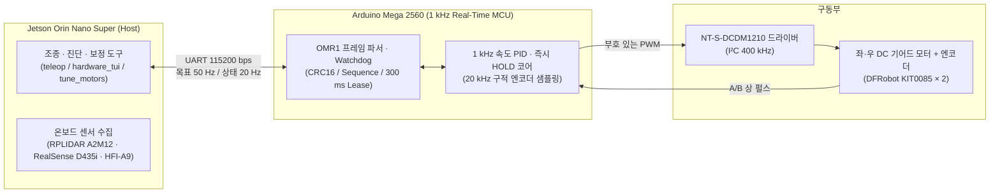

<p align="center">
  
</p>

<h1 align="center">Oh My Control</h1>

<p align="center">
  <em>모바일 로봇 1 kHz 모터 제어 펌웨어 · 구동/센서 캘리브레이션 · 터미널 통합 진단</em>
</p>

<p align="center">
  <a href="#driving-demo">주행 영상</a> ·
  <a href="#architecture">시스템 구조</a> ·
  <a href="#quick-start">바로 실행</a> ·
  <a href="#teleop-and-hold">주행 · 위치 유지 제어</a> ·
  <a href="#tui-and-diagnostics">센서 진단 · TUI</a> ·
  <a href="#calibration">구동 · IMU 보정</a> ·
  <a href="#firmware-and-network">펌웨어 · 네트워크</a> ·
  <a href="#docs">상세 문서</a>
</p>

---

**Oh My Control**은 [`Oh-My-MobileRobot`](https://github.com/Leehyunbin0131/Oh-My-MobileRobot)에서 설계·제작한 모바일 로봇 베이스의 **구동 제어 펌웨어, 센서·구동 보정 파이프라인, 온보드 진단 도구**를 담은 저장소입니다.

상위 ROS 2 자율주행 스택을 결합하기 전 단계로서, 로봇의 하위 제어기(Arduino Mega 2560)와 온보드 센서(RPLIDAR A2M12, RealSense D435i, HFI-A9 IMU)가 물리적 제어 명령과 좌표계 기준대로 동작하도록 보정하고 검증하는 역할을 담당합니다.

<a id="driving-demo"></a>

## 구동 검증과 외형

<table align="center"><tr><td>

https://github.com/user-attachments/assets/bb98cf7c-ee6c-49f0-b458-9154ca7bda5a

</td></tr></table>

<p align="center">
  <sub>실기 주행 · <a href="docs/videos/robot-driving.mp4">원본 영상 (MP4)</a></sub>
</p>

| 전면 | 전면 사시 | 측면 · 상판 |
| :---: | :---: | :---: |
|  |  |  |

<a id="architecture"></a>

## 제어 시스템 구조

연산 계층은 상위 명령·센서 처리를 담당하는 **Jetson Orin Nano Super**와 실시간 폐루프 모터 제어를 전담하는 **Arduino Mega 2560**으로 분리되어 있습니다.



### 하드웨어 및 제어 사양

| 구분 | 구성 | 인터페이스 · 동작 규격 |
| --- | --- | --- |
| 메인 연산 | Jetson Orin Nano Super | 목표 속도 50 Hz 송신, 상태 텔레메트리 20 Hz 수신, 센서 진단·보정 |
| 실시간 제어 MCU | Arduino Mega 2560 | Timer1 **1000 Hz (1 ms)** 속도·위치 제어, **20 kHz** 엔코더 샘플링 |
| 모터 드라이버 | NT-S-DCDM1210 | I²C 400 kHz (주소 `0x01`, Mega SDA20/SCL21), 부호 있는 PWM 출력 |
| 구동 모터 · 엔코더 | DFRobot KIT0085 × 2 | 명목 2652 counts/rev, 기본 72 RPM (운용 상한 95 RPM, 과속 차단 100 RPM) |
| 라이다 · 깊이 카메라 | RPLIDAR A2M12, RealSense D435i | 라이다 256000 bps (`rplidar_ros`), RGB·깊이 640 × 480 @ 15 fps 및 내장 IMU |
| 외장 IMU | HFI-A9 | USB 시리얼 921600 bps, 3축 자이로·가속도·자력계 및 자세 출력 |

### 바퀴 채널과 방향 매핑

전방은 RealSense 카메라가 바라보는 방향이며, 좌우는 로봇 뒤에서 전방을 바라볼 때의 기준입니다. 오른쪽 모터는 전원선 극성을 반전한 배선을 사용합니다.

| 실제 바퀴 | 드라이버 채널 | 엔코더 핀 (A / B) | 전진 명령 부호 | 전진 시 원시 엔코더 부호 |
| --- | --- | --- | --- | --- |
| 왼쪽 | L / M2 | D50 / D51 | − | − |
| 오른쪽 | R / M1 | D40 / D41 | − | + |

물리 방향과 채널 매핑은 [`config/drive_calibration.json`](config/drive_calibration.json)에 정의되어 있으며, 호스트 도구가 실제 전진 방향을 양수로 정규화합니다.

<a id="quick-start"></a>

## 바로 실행

저장소를 처음 내려받을 때는 라이다 드라이버 서브모듈(`src/rplidar_ros`)을 함께 초기화합니다.

```bash
git clone --recurse-submodules https://github.com/Leehyunbin0131/Oh-My-Control.git
cd Oh-My-Control
```

로봇에 접속한 뒤 용도에 맞는 실행 진입점을 사용합니다.

```bash
./hardware_tui.sh --motors       # 센서·모터 통합 터미널 대시보드 (모터 비구동)
./check_sensors.sh               # 외장 IMU, 라이다, 카메라·내장 IMU 일괄 점검
./teleop.sh                      # 키보드 폐루프 PID 주행 조종 (기본 72 RPM)
```

원격 SSH에서 대시보드를 바로 실행할 때는 `ssh -t hyunlee@<로봇주소> 'cd ~/ros2_dev_ws && ./hardware_tui.sh'`와 같이 의사 터미널(`-t`)을 할당합니다.

<a id="teleop-and-hold"></a>

## 주행 조종과 정지 위치 유지 (`HOLD`)

`./teleop.sh`는 방향키를 한 번 누르면 해당 목표 속도를 계속 유지하며, 정지 키(`s` 또는 `Space`)를 누르면 정지합니다.

| 키 | 동작 |
| --- | --- |
| `q` / `w` / `e` | 좌측 곡선 전진 / 직진 / 우측 곡선 전진 |
| `a` / `d` | 제자리 좌회전 / 우회전 (PID 모드 최대 50 RPM 제한) |
| `z` / `x` / `c` | 좌측 곡선 후진 / 직선 후진 / 우측 곡선 후진 |
| `s` / `Space` | 정지 및 위치 유지(`HOLD`) 진입 |
| `+` / `-` | 목표 속도 2 RPM씩 증감 (`--pwm` 직접 출력 모드에서는 10씩 증감) |
| `Ctrl+C` / `Ctrl+D` | 감속 정지 후 출력 해제 및 종료 |

* **속도 지정 및 개루프 진단**: `./teleop.sh --rpm 50`으로 목표 RPM을 변경할 수 있으며, `./teleop.sh --pwm 180`은 피드백 제어 없이 PWM을 직접 인가합니다. `--key-timeout 0.6`을 지정하면 키 입력이 없을 때 자동으로 정지합니다.
* **정지 위치 유지(`HOLD`)**: 정지 명령(`SET_SPEED 0 0`)이 적용되는 첫 제어 주기에 현재 엔코더 카운트를 기준 위치로 저장하고 `HOLD` 상태로 전환합니다. 직접 위치 비례항(18 PWM/count)과 유지 전용 속도 피드백(Kp 8.0, Ki 0.0, PWM 상한 350)으로 제동 및 정지 위치를 유지합니다.
* **명령 유효기간과 보호 동작**: 목표 속도의 유효기간(Lease)은 300 ms입니다. 통신 단절, 과속(100 RPM 초과 100 ms 지속), 위치 유지 이탈 한도(100 counts) 또는 출력 포화(1000 ms)가 발생하면 즉시 출력을 차단하고 오류 코드를 기록합니다. 원인을 해소한 뒤 `./teleop.sh --clear-fault`로 해제합니다.

<a id="tui-and-diagnostics"></a>

## 센서 점검과 터미널 대시보드 (TUI)

개별 센서와 엔코더 배선은 `./check_sensors.sh`로 독립 점검할 수 있습니다.

```bash
./check_sensors.sh --sensors imu
./check_sensors.sh --sensors lidar --lidar-baud 256000
./check_sensors.sh --sensors camera --duration 10
./check_sensors.sh --sensors motors --motor-test encoders --duration 20
```

* `camera`: RGB·깊이 영상 수신 주기와 내장 가속도계·자이로 스트림을 함께 검사합니다.
* `encoders`: 측정 시간 동안 두 바퀴를 손으로 돌려 A/B 상 카운트 증가와 불효 전이 여부를 확인합니다.
* `drive` / `bench`: 바퀴를 공중에 띄운 상태에서 `./check_sensors.sh --sensors motors --motor-test drive`로 실제 구동 응답을 점검합니다.

터미널 대시보드(`./hardware_tui.sh`)는 URDF 기반 3D 와이어프레임 자세, 카메라 컬러·깊이 문자 영상, 라이다 포인트 분포, 엔코더·모터 제어 상태를 실시간으로 렌더링합니다.

| 대시보드 키 | 동작 |
| --- | --- |
| `1` / `2`, `z` | 외장 IMU / 카메라 내장 IMU 전환, 현재 자세를 화면 기준 영점으로 설정 |
| `c`, `+` / `-` | 카메라 컬러·깊이 모드 전환, 라이다 표시 반경 조절 |
| `s`, `r`, `q` | 상태 스냅샷 저장, 센서 드라이버 재시작, 종료 |
| `m`, `Space` / `x` | 모터 구동 검사 시작 (`--motor-test drive` 활성화 시), 구동 중단·정지 |

<a id="calibration"></a>

## 구동 · PID · IMU 보정

### 모터 피드포워드 및 PID 오토튠

바퀴를 지면에서 띄운 상태에서 실행하며, 보정 결과와 검증 통계는 [`config/motor_pid.json`](config/motor_pid.json)에 기록됩니다.

```bash
./tune_motors.sh              # 구간별 PWM-RPM 특성 측정 기반 피드포워드·PI 보정 및 제동 검증
./tune_motors.sh --autotune   # 계단 응답 기반 바퀴별·방향별 Kp/Ki/Kd 자동 탐색 및 교차 검증
```

### 정지 자이로 영점 보정

로봇을 수평 정지 상태로 두고 외장 IMU(HFI-A9)와 카메라 내장 IMU(RealSense D435i)의 자이로 바이어스를 측정·검증합니다. 결과는 [`config/imu_calibration.json`](config/imu_calibration.json)에 저장됩니다.

```bash
./calibrate_imu.sh --stationary                 # 두 IMU 동시 수집·검증
./calibrate_imu.sh --stationary --sensors imu   # 외장 IMU 단독 보정
./calibrate_imu.sh --stationary --sensors camera
```

<a id="firmware-and-network"></a>

## 펌웨어 빌드 · 테스트 · 야외 핫스팟

### 환경 구성 및 펌웨어 빌드

새 환경에서 Python 의존성과 로컬 Arduino CLI(`.tools/arduino/`)를 준비할 때는 아래 명령을 실행합니다.

```bash
/usr/bin/python3 -m pip install pyserial numpy Pillow wcwidth

mkdir -p .tools/arduino/bin .tools/arduino/data .tools/arduino/downloads .tools/arduino/sketchbook
curl -fsSL https://raw.githubusercontent.com/arduino/arduino-cli/master/install.sh | BINDIR=.tools/arduino/bin sh
cat > .tools/arduino/arduino-cli.yaml << 'EOF'
directories:
  data: .tools/arduino/data
  downloads: .tools/arduino/downloads
  user: .tools/arduino/sketchbook
EOF
./.tools/arduino/bin/arduino-cli --config-file .tools/arduino/arduino-cli.yaml core update-index
./.tools/arduino/bin/arduino-cli --config-file .tools/arduino/arduino-cli.yaml core install arduino:avr
```

펌웨어 컴파일·업로드 및 단위 테스트 실행 명령은 다음과 같습니다.

```bash
./mega_firmware.sh build                              # Mega 모터 제어 펌웨어 빌드
./mega_firmware.sh upload                             # 펌웨어 업로드 (모터 전원 차단 상태에서 실행)
/usr/bin/python3 -m unittest discover -s tests -v     # C++ 제어 코어·프로토콜·보정 도구 단위 테스트
```

### 야외 SSH용 핫스팟 전환

실외 주행 시험 등 공유기가 없는 환경에서는 로봇을 Wi-Fi AP(`ORINBOT`, 비밀번호 `12345678`, 고정 주소 `10.42.0.1`)로 전환해 SSH로 접속할 수 있습니다.

```bash
sudo ./hotspot_on.sh             # 부팅 시 자동 AP 시작 활성화 + 5초 후 핫스팟 전환
sudo ./hotspot_on.sh --boot-only # 현재 연결 유지, 다음 부팅부터 핫스팟 적용
sudo ./hotspot_off.sh            # 부팅 자동 시작 해제 (현재 연결 유지)
sudo ./hotspot_on.sh --status    # 현재 Wi-Fi 연결 상태 및 SSH 접속 주소 확인
```

<a id="docs"></a>

## 상세 문서와 저장소 구성

| 문서 · 경로 | 내용 |
| --- | --- |
| [모터 제어 명세](docs/motor_control_spec.md) | 1 kHz 속도 PID, 정지 위치 유지(`HOLD`), `OMR1` 프레임 프로토콜 및 오류 보호 규격 |
| [제어·통신 주기 기준](docs/control_timing.md) | 호스트-MCU 제어 주기 설계, 역할 분담 원칙 및 UART 링크 왕복 지연 프로파일링 |
| [IMU 정지 자이로 보정](docs/imu_calibration.md) | HFI-A9·RealSense D435i 정지 자이로 바이어스 추정·검증 절차와 좌표계 적용 원칙 |
| [`config/`](config/) | 구동 방향([`drive_calibration.json`](config/drive_calibration.json)), PID 계수([`motor_pid.json`](config/motor_pid.json)), IMU 바이어스([`imu_calibration.json`](config/imu_calibration.json)) |
| [`firmware/mega_motor_test/`](firmware/mega_motor_test/) | Arduino Mega 2560 제어 루프(`velocity_core.h`), 상태·오류 감시(`test_core.h`), 스케치 |
| [`tools/`](tools/) · [`tests/`](tests/) | 조종·보정·센서 진단·TUI 파이썬 모듈 및 C++/Python 자동 테스트 스위트 |
| [`NT-S-DCDM1210.pdf`](NT-S-DCDM1210.pdf) · [`resources/`](resources/) | 모터 드라이버 매뉴얼 및 TUI 렌더링용 참조 URDF 모델 |

## 라이선스

저장소의 펌웨어, 제어·보정 도구, 테스트 및 문서에는 [Apache-2.0](LICENSE)을 적용합니다.
기구 설계 및 참조 URDF 모델의 출처는 [Oh-My-MobileRobot](https://github.com/Leehyunbin0131/Oh-My-MobileRobot)이며, 모델 라이선스([CERN-OHL-P-2.0](resources/LICENSE.robot-model))와 고지([NOTICE.robot-model](resources/NOTICE.robot-model))를 보존했습니다.
라이다 드라이버 서브모듈 출처: [Slamtec/rplidar_ros](https://github.com/Slamtec/rplidar_ros/tree/ros2).
